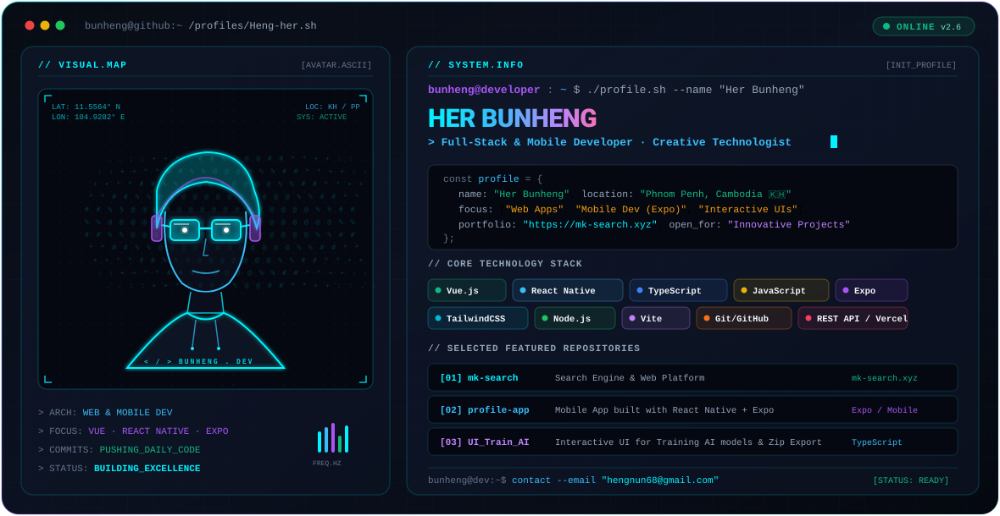

<div align="center">

<!-- Hero Banner (Theme Adaptive: switches automatically between dark and light modes) -->
<picture>
  <source media="(prefers-color-scheme: dark)" srcset="./dark.svg" />
  <source media="(prefers-color-scheme: light)" srcset="./light.svg" />
  
</picture>

<br/>

<!-- Animated Typing Effect -->
<p align="center">
  <a href="https://github.com/Heng-her">
    
  </a>
</p>

<!-- Quick Badges -->
<p align="center">
  
  
  <a href="mailto:hengnun68@gmail.com">
    
  </a>
  <a href="https://mk-search.xyz">
    
  </a>
</p>

</div>

---

### 🚀 About Me

```bash
bunheng@developer:~$ whoami
```

```json
{
  "name": "Her Bunheng",
  "alias": "Heng-her",
  "role": "Full-Stack & Mobile Developer",
  "location": "Phnom Penh, Cambodia 🇰🇭",
  "education_journey": "Self-driven software engineer building modern applications",
  "tech_passions": ["Interactive UI/UX", "Mobile Cross-Platform Apps", "AI Tools & APIs"],
  "hobbies": ["Exploring new tech frameworks", "Coding real-world projects", "Continuous learning"]
}
```

- 🔭 **Currently working on:** Innovative web applications, search discovery tools, and cross-platform mobile apps.
- 🌱 **Specializing in:** **Vue.js**, **React Native / Expo**, **TypeScript**, and modern API architectures.
- 💬 **Ask me about:** Frontend architecture, building mobile apps with Expo, and responsive UI engineering.
- 📫 **How to reach me:** [hengnun68@gmail.com](mailto:hengnun68@gmail.com)
- ⚡ **Fun fact:** I love turning clean code into beautiful, futuristic user experiences.

---

### 🛠️ Tech Stack & Arsenal

<div align="center">

#### Languages
<p>
  
  
  
  
</p>

#### Frontend & Mobile
<p>
  
  
  
  
  
</p>

#### Backend, Services & Deployment
<p>
  
  
  
  
  
  
</p>

</div>

---

### 📂 Featured Projects & Highlights

| Project | Description | Tech Stack | Live / Repo |
| :--- | :--- | :--- | :--- |
| 🔍 **[mk-search](https://github.com/Heng-her/mk-search)** | Custom search engine and discovery platform | `Vue` · `Vite` · `Tailwind` | [🌐 Live Demo](https://mk-search.vercel.app) |
| 📱 **[profile-app](https://github.com/Heng-her/profile-app)** | Cross-platform mobile portfolio app | `React Native` · `Expo` · `TypeScript` | [🌐 Preview](https://profile-app-pi-tan.vercel.app) |
| 🤖 **[UI_Train_AI](https://github.com/Heng-her/UI_Train_AI)** | AI model training interface with export features | `TypeScript` · `Web Tools` | [🌐 Live Demo](https://ui-train-ai.vercel.app) |
| 🏬 **[nealika-pos](https://github.com/Heng-her/nealika-pos-landing-page)** | High-converting landing page for POS retail system | `TypeScript` · `Modern CSS` | [📁 Repository](https://github.com/Heng-her/nealika-pos-landing-page) |
| ☁️ **[api-upload-image](https://github.com/Heng-her/api-upload-image)** | Image upload API server deployed on cloud | `Node.js` · `Render` | [🌐 API Service](https://api-upload-image-8ym9.onrender.com) |

---

### 📊 GitHub Activity & Metrics

<div align="center">
  <table border="0">
    <tr>
      <td>
        
      </td>
      <td>
        
      </td>
    </tr>
    <tr>
      <td colspan="2" align="center">
        
      </td>
    </tr>
  </table>
</div>

---

### 💬 Connect With Me

<div align="center">
  <a href="https://github.com/Heng-her">
    
  </a>
  <a href="mailto:hengnun68@gmail.com">
    
  </a>
  <a href="https://mk-search.xyz">
    
  </a>
</div>

<br/>

<div align="center">
  <sub>⚡ Designed &amp; Crafted with passion by <b>Her Bunheng</b> • Phnom Penh, Cambodia 🇰🇭</sub>
</div>
